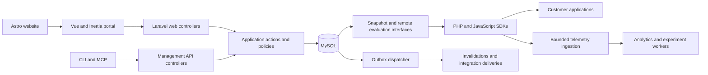

# BitFlag architecture

[Documentation index](README.md)

## System boundaries

The website explains the product. The portal manages customer organizations and configurations. The delivery interfaces distribute authorized published configuration to applications. SDKs make local decisions where the credential and visibility model permit it. Analytics and experiment processing run asynchronously.

This diagram shows logical responsibilities, not a mandatory microservice topology. Web, delivery, streaming, and worker processes can use the same backend repository while receiving separate resources and deployment controls. Astro and SDK repositories have independent release processes.

## Technology responsibilities

| Technology | Responsibility | Boundary |
| --- | --- | --- |
| Astro | Public pages and optional interactive islands | No customer flag administration or secret-bearing SDK configuration |
| Starlight | Customer documentation navigation and content | Published documentation, not internal operating credentials |
| Vue and TypeScript | Interactive portal, editors, tables, charts, local form state | Server remains authoritative for authorization and publication |
| Inertia | Laravel-to-Vue page navigation and initial page data | Does not replace management or SDK APIs |
| Laravel | Application actions, authentication, policies, persistence, APIs, jobs | Evaluator core remains independent of Laravel |
| MySQL | Authoritative management state, published snapshots, audit and durable event records | Redis cannot be the only source of published configuration |
| Redis | Cache, queues, rate limits, coordination and invalidation fanout | Failure must not corrupt or erase published revisions |
| Object storage | Large exports, backup artifacts, immutable artifacts | Private access only; never a public cache of private configuration |

Astro's island model supports selectively interactive public content. Inertia connects server routes to client-rendered pages; it does not dictate how every component manages its local state. These are framework capabilities; the boundaries above are BitFlag design choices. Sources: [Astro islands](https://docs.astro.build/en/concepts/islands/), [Inertia introduction](https://inertiajs.com/docs/v3/getting-started).

## Backend modules

| Module | Owns | Example actions |
| --- | --- | --- |
| Identity | Accounts, authentication, MFA, sessions | RegisterAccount, RevokeSession |
| Organizations | Memberships, invitations, project roles | InviteMember, ChangeMembership |
| Projects | Project identity, metadata, archive/deletion workflow | CreateProject, ScheduleProjectDeletion |
| Environments | Environment identity, protection policy, ordering | CreateEnvironment, UpdateProtectionPolicy |
| Flags | Flag identity, variations, environment drafts, ordered flag rules, lifecycle | CreateFlag, SaveFlagDraft |
| Targeting | Reusable segment definitions, predicate structures and reference analysis | SaveSegmentDraft, PreviewSegment |
| Publishing | Frozen proposals, approvals, snapshot compilation, live revision pointer | RequestPublicationReview, PublishEnvironment, RollbackEnvironment |
| Credentials | SDK keys, project management tokens, personal access tokens, rotation and revocation | IssueSdkKey, RotateSdkKey |
| Experiments | Experiment definitions, assignment plan, attribution and analysis configuration | PrepareExperimentStart, EndMeasurement |
| Analytics | Ingestion, aggregates, coverage and SDK observations | AcceptEventBatch, BuildUsageAggregate |
| Integrations | Webhooks, provider connections, deliveries, code-reference scans | ConnectProvider, RetryWebhook |
| Audit | Audit record structure, redaction, queries and export | ExportAuditLog |
| Billing | Subscription state, provider events, entitlements, usage limits | ApplyBillingEvent, ChangeSubscription |

Evaluation is a pure core in `bitflag-php` and `bitflag-js`, not another database-owning backend module. Backend adapters construct its inputs and consume its results. Publishing owns the compiler that assembles domain data into that core's snapshot contract.

## Request and application boundaries

An HTTP controller validates request shape, resolves explicit actor and tenant context, calls an application action, and formats the result. A form request is not the sole authorization or domain-validation boundary: non-HTTP callers must receive the same checks.

An action:

1. Confirms the actor, organization, scopes and resource permissions.
2. Loads tenant-scoped state and checks expected versions.
3. Invokes domain rules and transition guards.
4. Performs the required database transaction.
5. Returns a typed result or structured application error.

Portal controllers return Inertia pages or targeted responses. API controllers return versioned JSON. Neither owns a second implementation of publication, targeting, or billing rules. Side effects occur through the outbox where delivery must survive process failure.

## Patterns and their purpose

| Pattern | BitFlag use |
| --- | --- |
| Modular monolith | Clear ownership while retaining one coordinated backend application |
| Application actions | One reusable implementation of each business operation |
| Selective domain modeling | Typed values, contexts, allocations, proposals and transitions enforce important invariants |
| Read/write separation | Query classes assemble page/report data; actions enforce mutations; no mandatory separate read database |
| Immutable snapshots | Published behavior does not change when draft records change |
| Optimistic concurrency | Stale editor saves and stale publication proposals fail explicitly |
| Transactional outbox | Database commit and durable notification intent succeed together |
| Idempotent consumers | Retried webhooks, billing events and background jobs do not repeat business effects |
| Provider adapters | External integrations expose a small internal contract independent of vendor payloads |

Full event sourcing is not required: audit entries are history, not the only reconstruction source. Generic repositories around every Eloquent model are not required. Use interfaces at useful boundaries such as external providers, clocks, snapshot storage, and transports.

## Ownership and dependency rules

- A module must not write another module's records directly. It calls that module's public action or an explicit orchestration contract.
- Publishing coordinates a transaction across owned operations where atomicity is required; module boundaries must not force eventually consistent live pointers or audit records.
- Read-only reporting joins are allowed through named query classes, with tenant scope and data classification preserved.
- Domain rules must not call controllers, inspect global requests, or silently discover a current tenant.
- Evaluation core must not depend on Laravel, Eloquent, browser globals, networking, billing, or telemetry emission.
- Integration failures must not reverse a committed publication. They become retryable delivery failures.
- Billing policy may restrict management actions according to the chosen plan. It must not silently change a flag's published value or evaluation semantics.
- `Shared` contains a small set of stable primitives and infrastructure contracts. Product logic has a named owner.

## Transactions and asynchronous work

Use synchronous transactions for small authoritative mutations. Long analysis, exports, code scans and provider calls run in bounded background jobs. Jobs carry tenant IDs and immutable object/version IDs, establish their own tenant scope, and avoid serializing credentials or raw personal context into payloads.

Keep permissions fresh for delayed customer-initiated actions. System aggregation jobs use explicit service authority rather than impersonating an expired session. Queue priority must isolate publication notifications from high-volume analytics work.

Laravel supplies background-job infrastructure; queue priorities, resource isolation and the durability rules are application design. [Laravel queues](https://laravel.com/docs/13.x/queues)

## Architecture verification

Architecture tests reject forbidden dependencies, evaluator-to-framework imports, controllers that bypass write actions, and cross-module writes through unsupported interfaces. Integration tests cover transactions spanning publication, audit, and the outbox. Read queries and background jobs have explicit cross-tenant tests.
