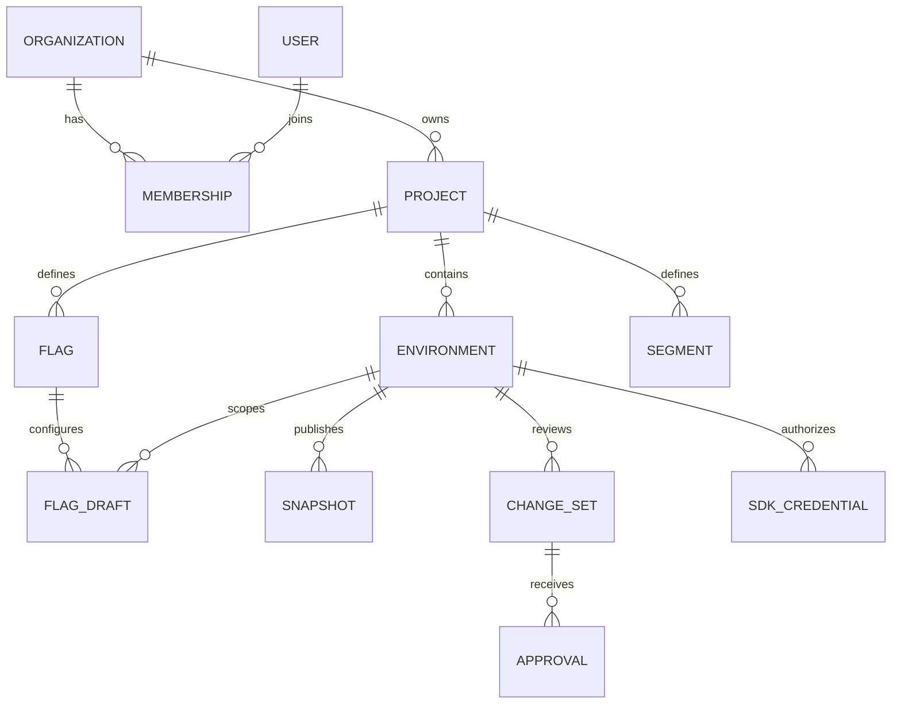

# BitFlag domain model

[Documentation index](README.md)

## Data ownership and tenant boundary

An organization is the tenant boundary. Users can belong to multiple organizations. Projects belong to one organization; environments and flag identities belong to a project. A request must resolve membership and scope from trusted authentication, then verify that every referenced resource belongs to that scope.

Stable opaque IDs (ULIDs) are used for relationships. Human-readable names and editable slugs are not identity inputs, and slug changes never reassign rollout cohorts, because bucketing depends only on a per-allocation salt.

This is a conceptual relationship diagram, not the complete schema. Cross-tenant references are rejected even where IDs are valid. Composite foreign keys enforce tenant and project ownership; application checks are never the only defense against malformed relationships.

## Persistence groups

| Group | Records | Key invariants |
| --- | --- | --- |
| Identity | users, sessions, MFA credentials/recovery material | Account state and session revocation enforced consistently |
| Organizations | organizations, memberships, invitations, project memberships | Membership unique per organization/user; last Org Owner and last project Owner protected. There are no service accounts |
| Projects | projects, project_settings | Project key unique within organization; ownership changes preserve isolation |
| Environments | environments, environment_policies | Environment key unique within project; live snapshot belongs to this environment |
| Flag definitions | flags, variation_versions, flag_metadata | Flag key unique within project; key/type immutable after first publication |
| Working configuration | environment_flag_drafts, rules, overrides | Draft version is checked on every write; defaults reference valid typed variations |
| Segments | segments, segment_versions, environment_segment_selections | Identity is project-scoped; each environment pins selected immutable content |
| Publication | environment_drafts, change_sets, approvals, snapshots | Proposal content frozen; revision unique and increasing within environment |
| Credentials | credentials (server and browser SDK keys and management keys per environment, personal tokens per user), credential rotations | Lookup metadata reveals no secret; token class and audience explicitly recorded; management keys are project-owned and scoped to one environment |
| Experiments | experiments, experiment_versions, metrics, attribution_records | Analysis tied to a frozen plan; one authoritative outcome per flag/environment |
| Telemetry | event_batches, event_deduplication, evaluation_aggregates, sdk_observations | Bounded retention, deduplication and reporting coverage |
| Integrations | provider_connections, webhook_endpoints, deliveries, code_scans | Tenant-owned credentials; identifiable retryable deliveries |
| Audit/outbox | audit_events, outbox_events, idempotency_records | Mutation and required durable records commit together |
| Billing | subscriptions, billing_events, entitlements, usage_aggregates | Provider event deduplication; usage and runtime evaluation have separate responsibilities |

A flag draft stores its rules, condition groups and prerequisites as one validated JSON document, with a reference index for dependency lookups. Versioning and publication invariants apply to the document as a whole. Indexes cover tenant, project and environment filters, unique keys, environment revisions, outbox readiness, audit chronology and delivery retry times.

## Flags and variations

A flag has identity, key, display name, description, type, owner, tags, temporary/permanent intent and lifecycle metadata. Boolean, String, Number and JSON are required value types. Optional JSON Schema validation and explicit size limits constrain JSON configuration.

Variations have stable keys and immutable value versions. A named variation can acquire a new draft value version without mutating the value inside an existing snapshot. The same applies to client visibility and evaluation-affecting metadata. Label/description edits can remain management metadata unless the delivery contract includes them in immutable snapshot content.

Every environment configuration defines enabled state, off variation, default on variation, ordered rules, prerequisites, overrides and applicable experiment assignment. Disabled returns the configured off variation. Unknown/unpublished returns the caller's fallback. These outcomes must not be conflated.

### Lifecycle and archive

Lifecycle is separate from per-environment serving state. A flag can be active globally while unpublished in staging or disabled in production. Deprecation warns about cleanup without changing live values.

Archiving is an explicit, dependency-checked workflow: the flag is marked as archiving, removal is staged in the affected environments, and the flag becomes archived once publications have removed it from every live snapshot. The intermediate state is shown rather than claiming all environments stopped serving instantly. Historical snapshots remain readable. Rolling back to a revision that contains an archived flag requires an explicit restore decision and current authorization.

An existing cached snapshot may continue serving its previous contents until refreshed or expired. Never promise that archive, deletion or credential revocation retracts already downloaded bytes.

## Rules and segments

A rule has stable ID, order, enabled state, condition tree, outcome and allocation configuration. First matching enabled rule wins. Rule reordering is a behavior change and must appear in the diff.

Conditions support typed equality/inequality, membership, prefix/suffix/contains, numeric comparisons, existence, semantic version and date comparisons. Case sensitivity, null handling, array membership and valid date/version representations are part of the protocol, not language defaults. No arbitrary script execution or remotely supplied regular expressions are supported.

Segments are reusable project identities with immutable predicate versions. An environment's draft selects segment versions; publishing one environment does not update others. Editing a segment shows every dependent flag and affected draft. Existing snapshots retain their frozen definitions.

Explicit include/exclude lists, if used, include subject kind and key. Segment precedence is explicit exclusion, then explicit inclusion, then predicate evaluation. Raw identifiers are sensitive management data, unlike anonymous aggregate counters. Mask them where permissions require it and prohibit private lists from browser-visible snapshots. Inclusion-list size is bounded.

Overrides belong to a flag and environment and contain subject kind/key, chosen variation, reason, creator and optional expiry. Expiry is encoded in the snapshot and interpreted using a supplied evaluation time. Simulation can fix that time for reproducibility; SDK documentation must state clock assumptions. Draft overrides must not affect live decisions before publication.

Prerequisites reference compatible flags in the same environment unless a later explicit contract adds another scope. Reject self-reference, cycles, missing references and excessive depth at publication. At runtime, invalid graphs produce an error/fallback result rather than recursive failure. An unmet valid prerequisite returns the parent flag's off variation.

## Drafts and change sets

There are four distinct workflow representations:

1. Local unsaved editor state in the browser.
2. Saved server drafts with optimistic versions.
3. Frozen review candidates with a content hash and base revision.
4. Immutable published environment snapshots.

An environment draft version advances whenever evaluation-affecting content selected for that environment changes. Per-object versions support precise save conflicts; the environment version detects changed publication proposals. Project-level shared edits must either create new immutable versions explicitly selected by drafts or invalidate every affected draft through a defined operation.

A change set freezes the base live revision, selected draft versions, compiled proposed content/hash, affected objects, contributors, reason and protection policy version. Publication never reads mutable draft content after approval without verifying it still matches the frozen proposal.

## Experiments

Experiments combine assignment through the normal evaluation path with exposure and conversion collection and a reviewed statistical method. Reporting is validated against controlled datasets; descriptive charts alone are not presented as a decision.

An experiment plan records:

- Flag and environment, hypothesis, owner, and eligible audience.
- Assignment unit (for example user or account), control and treatment variations, allocation and stable salt.
- Exposure trigger, primary metric, conversion event, attribution window and event-time policy.
- Guardrail definitions and the statistical method/version.
- Planned duration/sample requirements, decision criteria, exclusion rules and missing-data treatment.

Experiment versions are immutable. Significant allocation, metric or audience edits cannot silently mix old and new populations into the same analysis: each such change either creates a new experiment version or is forbidden while the experiment runs. Two active experiments cannot independently assign conflicting outcomes to the same flag and environment.

Lifecycle (there is no pause): draft → starting (experiment rule drafted and awaiting review and publication) → running → stopped with a recorded decision. Stopping measurement and publishing a winning variation are separate operations: the decision creates an ordinary draft that goes through review and publication. All serving changes use Publishing. Emergency flag disable takes precedence over assignment and is recorded as an interruption to the experiment.

Assignment, exposure and conversion are distinct. Fetching a snapshot is none of them. Exposures are deduplicated according to the assignment unit and plan, and conversions according to explicit event IDs and attribution rules. Late and out-of-order events are recorded without silently moving the analysis window. Allocation imbalance and guardrail failures are detected, and data-quality warnings appear alongside results.

Cross-event attribution requires a linkable experiment-scoped identifier or another defined join mechanism. Aggregate flag counters alone cannot provide it. Pseudonymous identifiers remain sensitive data with retention, deletion and access requirements. BitFlag does not claim that all identifiers are discarded while attribution data is retained.

## Organization and project lifecycle

Invitations expire and can be revoked; accepting an invite must not grant access to a different organization. Roles, project grants and environment publishing grants are evaluated together. Ownership transfers require an eligible target and preserve at least one owner.

A project has settings that only its Owners change: name, key, description, time zone, and the defaults every new flag starts with (key format, days without checks before a flag counts as stale, whether a description or an owner is required, and whether flags are client-visible). The settings form carries a `version`, so a save based on stale data fails instead of overwriting another person's edit. The project key is part of every address and is named by SDKs and the CLI, so it can change only until the first credential is issued or the first revision is published; after that it is fixed.

An environment has a display name, a key (a–z, 0–9 and dashes, starting with a letter, unique in the project), a label color and a position. The key can change until the environment's first publication and is fixed after that. Environments are listed in one order everywhere; reordering saves the full list of active environments and fails as a version conflict if the set changed meanwhile. Archived environments sort after the active ones and keep their key reserved. A new environment starts with version 1 of its protection policy, and every flag starts disabled in it. Creating one is limited by the plan (environments per project), and the plan can also make a project's configuration read-only; both checks run inside the action's transaction.

Project archive, scheduled deletion and restore are explicit workflows. A cross-organization transfer would have to migrate ownership-sensitive grants, integration bindings, billing responsibility and cache scope atomically or through a guarded maintenance state; it is not offered. Archived projects keep serving. Deleting a project is scheduled with a grace period, during which it can be restored.

Scheduled deletion and final purge are different states. Final purge revokes online access and follows the agreed retention policy for backups, billing and audit. The UI must explain cached SDK behavior instead of promising immediate fallback everywhere.

## Time, retention and data classification

Store server timestamps in UTC and display user-local time with an exact UTC detail. Treat event time and ingestion time separately. Bound client clock skew; do not use arbitrary client timestamps to establish approval validity or management ordering.

Classify data as public website content, tenant management data, credential secrets, public browser configuration, private server configuration, aggregate telemetry, or attributable experiment data. Each class has an explicit retention, export and deletion policy.
